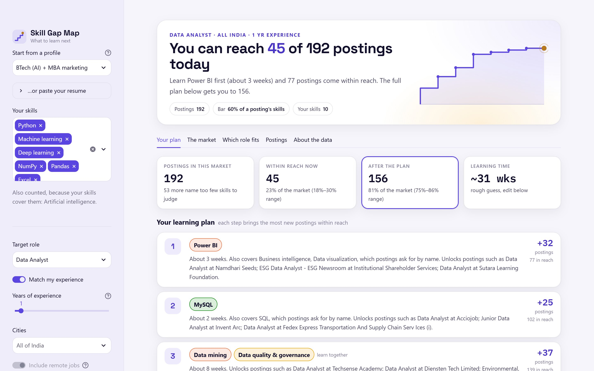
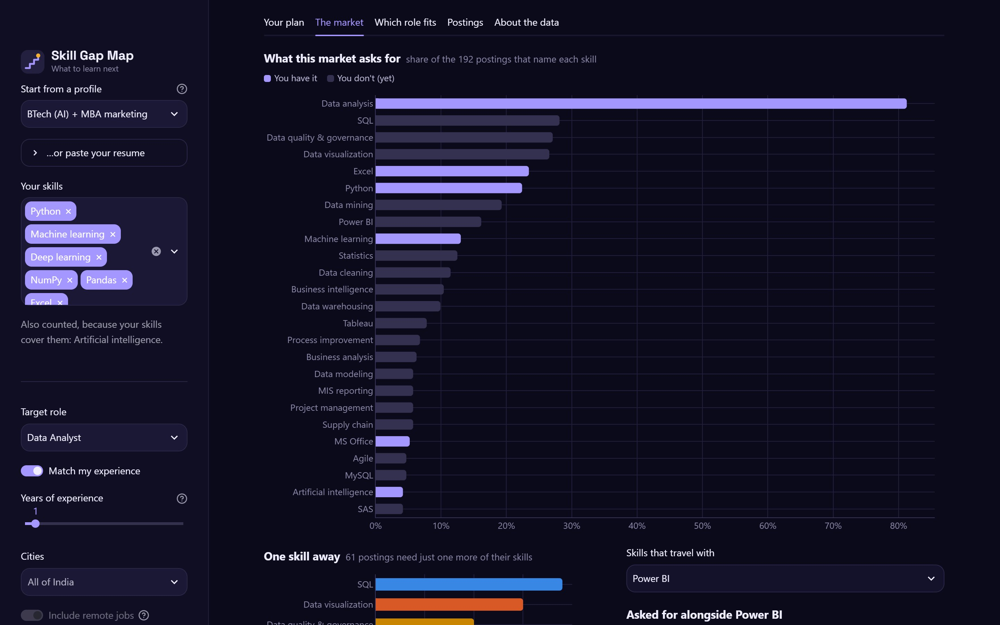
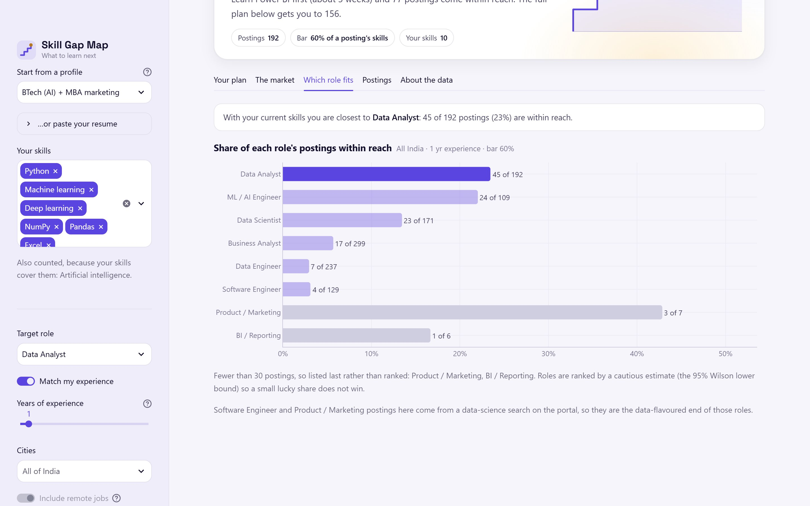
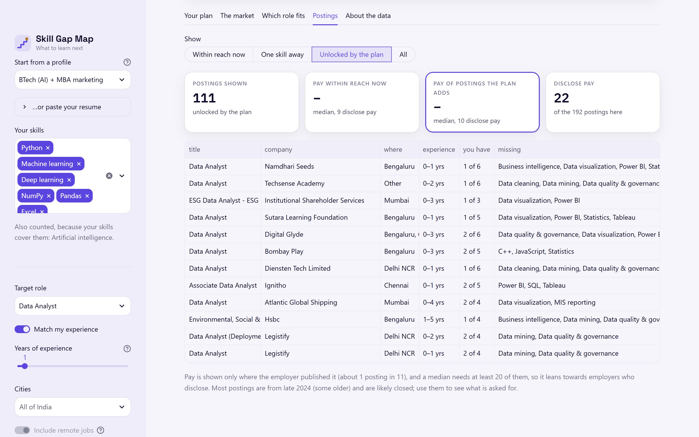
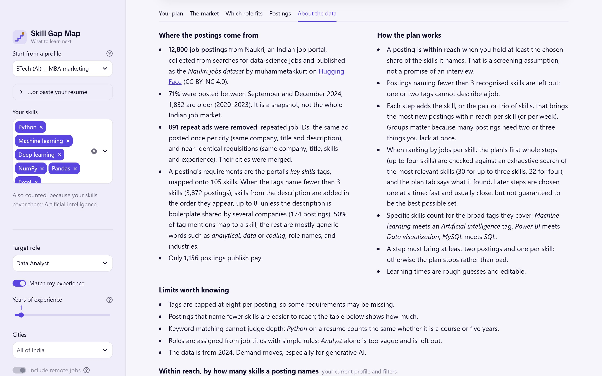

# Skill Gap Map · what to learn next, measured on real job postings

**Stop guessing what to learn next.** Enter your skills (or paste your resume), pick a target role, and Skill Gap Map
reads 12,800 real Indian job postings to find the next skill, or pair or trio of skills, that brings the most jobs
within your reach.

**▶ Try it:** https://skill-gap-map.vercel.app/app/  ·  **Overview:** https://skill-gap-map.vercel.app

It runs entirely in your browser (Python compiled to WebAssembly via [stlite](https://github.com/whitphx/stlite)), so
your resume never leaves your machine. The first visit downloads Python and takes about 20 seconds.



<table>
  <tr>
    <td width="50%"><br><sub><b>The market</b> (dark mode): what postings ask for, and the postings one skill away</sub></td>
    <td width="50%"><br><sub><b>Which role fits</b>: the same skills scored against eight roles</sub></td>
  </tr>
  <tr>
    <td><br><sub><b>Postings</b>: the actual jobs you'd unlock, with what's missing</sub></td>
    <td><br><sub><b>About the data</b>: source, coverage and limits, in plain words</sub></td>
  </tr>
</table>

## The problem
Graduates are told to "upskill" but not *which* skill. Course lists don't say how many real jobs a skill opens for
someone with your background. Skill Gap Map answers that with data: for your current skills, target role, experience
and city, which skill brings the most actual postings within reach?

## What it does
| Tab | What you get |
|---|---|
| **Your plan** | How many postings are within reach today (with a 95% range), and a step-by-step plan: single skills, or pairs and trios that only pay off together, with the postings each step unlocks |
| **The market** | The skills this market asks for most (yours highlighted), the postings you're one skill away from, and which skills travel together |
| **Which role fits** | The same skills scored against eight roles, ranked cautiously so tiny samples don't win |
| **Postings** | The postings within reach, one skill away, or unlocked by the plan, with what you're missing; pay where it's disclosed |
| **About the data** | Source, licence, coverage, method and limits, plus how reach varies with posting size |

## Method (and why)
| Step | Method | Why |
|---|---|---|
| Skills | 105 canonical skills; 521 tag spellings map onto them (`power bi`, `microsoft power bi`, `dax` → Power BI). Role names, soft skills, industries and filler words (*analytical*, *data*, *coding*) map to nothing | Portal tags are messy; a skill should count once, however it's spelled |
| Requirements | A posting's *key skills* tags (at most 8). Only when they name fewer than 3 skills does the description fill in, in order of mention, up to 8, and never from boilerplate shared word for word by several companies | Long descriptions list nice-to-haves; counting them made short postings look easy and long ones impossible |
| Reading text | Word-boundary patterns; ambiguous words (*R*, *Go*, *Excel*, *React*, *Spark*, *AI*) count only in unambiguous forms | "I excel at teamwork" is not Excel; "Go-to-market" is not Go |
| Implied skills | Specific skills meet the broad tags they cover: Machine learning → *Artificial intelligence*, Power BI → *Data visualization*, MySQL → *SQL* | Otherwise an ML graduate is told to "learn AI" |
| Within reach | You hold at least 60% of a posting's skills (50% and 70% selectable), shown in whole skills: 2 of 3, 3 of 5, 5 of 8 | A screening assumption, stated openly; not a promise of an interview |
| Thin postings | Postings with fewer than 3 recognised skills are left out of fit, and counted | One or two tags can't describe a job |
| Plan | Greedy: each step adds the skill, pair or trio that brings the most new postings within reach per skill (or per week of learning). A step must bring at least 2 postings and 1 per skill, or the plan stops | Many postings need 2–3 missing skills at once; and one-posting steps are noise |
| Plan check | When ranking by jobs per skill, the plan's first whole steps (up to 4 skills) are compared with an exhaustive search of the most relevant skills (30 for ≤3 skills, 22 for 4); the app shows the result, and the gap if a fixed set does better | Greedy isn't guaranteed optimal under a threshold, so it is checked, not assumed |
| Role fit | Ranked by the Wilson 95% lower bound of the share within reach; roles with fewer than 30 postings are listed last | 3 of 7 postings shouldn't outrank 45 of 192 |
| Pay | Median of the posted range's midpoint, only where pay is disclosed (1,156 postings), at least 20 per median, and only compared within the same experience filter | Most postings hide pay, and without an experience filter a comparison would show seniority, not skills |
| Duplicates | 891 repeat rows removed: repeated IDs, the same ad per city, and near-identical requisitions (same company, title, skills, experience) | One employer's 24 copies of an ad shouldn't steer a plan |

## How it was validated
- **171 automated tests** (`python -m pytest -q`): hand-worked markets, the plan vs **brute force on 25 random
  markets** (every step of up to three skills matched the best possible set), the exhaustive checker vs brute force,
  the Wilson bound against textbook values, implied skills, the resume reader on tricky phrases, the data pipeline
  (dedupe, requirements, salaries, titles, cities), and headless runs of the whole app.
- **Hand check of the description reader:** in 30 random postings where descriptions fill in missing tags, 89 of 93
  skills read were genuine requirements. The one clear miss ("data structures and pipelines" read as DSA) is fixed;
  the rest came from degree names such as "a degree in Statistics".
- **Two independent reviews.** A strict methods review found 15 issues, including description skills inflating
  posting sizes, duplicate ads inflating gains, a crash in the learning-time editor, and claims that overreached. A
  second QA pass drove the app through about 700 setting combinations and found the rest: "learn Artificial
  intelligence" advice for ML graduates, boilerplate descriptions, and stale numbers. All were fixed with regression
  tests.
- **End-to-end browser tests** (Playwright, 19 checks) of the in-browser build: every tab, the resume reader, role,
  bar and ranking changes, the CSV download, an empty market, and phone width in dark mode.

## Data
Postings come from the *Naukri jobs dataset* by muhammetakkurt on
[Hugging Face](https://huggingface.co/datasets/muhammetakkurt/naukri-jobs-dataset), file `naukri_data_scientist.jsonl`,
licensed **CC BY-NC 4.0**. They were collected from data-science searches on Naukri: 71% were posted September to
December 2024, and 1,832 are older (2020–2023). `data/postings.csv.gz` is a processed subset and inherits that licence
(non-commercial, with attribution). This project is not affiliated with Naukri. Rebuild it with:
```bash
python scripts/prepare_data.py
```

## Run it locally
```bash
pip install -r requirements.txt
streamlit run app.py
```

## Project structure
| Path | Purpose |
|---|---|
| `skills.py` | The skills dictionary, tag mapping, implied skills and the resume/description reader |
| `gap_engine.py` | Markets, reachability, the learning plan, the exhaustive check, role fit |
| `app.py`, `ui.py`, `.streamlit/config.toml` | Streamlit app, design system, light/dark theme |
| `scripts/prepare_data.py` | Raw postings → `data/postings.csv.gz` and `data/coverage.json` |
| `scripts/showcase_data.py` | Computes every number on the overview page with the engine (a test keeps them in sync) |
| `tests/` | Skills, engine, data, app smoke and web-sync tests |
| `docs/index.html` | Scroll-animated overview page ("the climb") |
| `docs/app/` | In-browser build (stlite); refresh with `python scripts/build_web.py` |

## Limitations
- The data is a snapshot from data-science searches on one portal, not the whole Indian job market. Software and
  marketing roles appear only at their data-flavoured end, and Product / Marketing and BI have few postings.
- Postings that name fewer skills are easier to reach; the About tab shows how much for your profile.
- Keyword matching can't judge depth: a course and five years of Python count the same.
- Some portal tags are broad (*Data quality & governance*, *Data mining*) and show up in plans because recruiters use
  them, even when the job hardly needs them.
- Learning times are rough guesses (editable in the app).
- In the in-browser build, the download button logs one harmless console message on load (an stlite pre-fetch); the
  download itself works.
